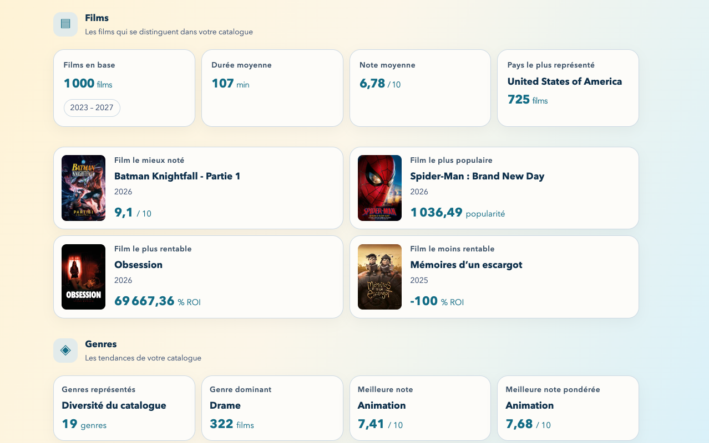

# TMDB Discovery App - 2.0.0

exploration des données - backlog

---

# Objectifs

## Application

- Mettre en place le dashboard pour l'exploration des données

## Ingénierie logicielle

- utilisation du backlog pour organiser et planifier les tâches à réaliser pour la version 2.0.0.
- fork du projet themoviedb-discovery-app pour repartir sur une base existante et intégrer les évolutions nécessaires pour la version 2.0.0.

<!--

-->

---

# front-end - dashboard

<!--

-->

---

# front-end - dashboard (suite)

Le dashboard permet d'afficher et d'analyser les données provenant de TMDB. 

Chaque vignette représente un élément de données, il sera ensuite possible de cliquer dessus pour obtenir plus de détails et effectuer des actions spécifiques.

L'ensemble des données explorées dans le dashboard provient des données **Movies** de TMDB en exploitant les API:
- **discover-movie** (https://developer.themoviedb.org/reference/discover-movie), 
- **movie-details** (https://developer.themoviedb.org/reference/movie-details)

Et 2 autres API pour compléter les informations:
- **genre-movie-list** (https://developer.themoviedb.org/reference/genre-movie-list)
- **configuration-countries** (https://developer.themoviedb.org/reference/configuration-countries)

---

# dashboard - front-end/back-end

Mise en oeuvre d'une base de données locale pour stocker les données historiques.

Afin d'avoir un historique sur plusieurs années, le dashboard n'exploite pas directement les API de TMDB pour chaque requête. Il s'appuie sur une base de données locale qui stocke les données (échantillon) sur plusieurs années, permettant ainsi d'effectuer des analyses historiques et de suivre l'évolution des données au fil du temps.

La version 2.0.0 s'appuie donc sur 2 évolutions majeures :
- back-end :
  - L'utilisation d'une base de données locale pour stocker les données historiques.
  - Exposition d'API pour accéder aux données stockées localement.
- front-end :
  - Mise en oeuvre du dashboard pour l'exploration des données.
  - Interaction avec les API exposées par le back-end pour récupérer les données historiques.

---

# fork

Le **fork** consiste à créer une copie indépendante du projet original sur notre compte GitHub. 

Cela nous permet de travailler sur notre version personnalisée du projet sans impacter le projet initial.

Il permet également de suivre les évolutions du projet original et d'intégrer les mises à jour si nécessaire. 

Ce mécanisme est utilisé dans les projets open source pour permettre aux contributeurs de travailler sur des versions personnalisées tout en restant synchronisés avec le projet principal.

---

# themoviedb-discovery-app

Fork de la version originale du projet themoviedb-discovery-app 1.0.0

Afin de mettre en place cette version 2.0.0 sur de bonnes bases, nous allons forker le projet [themoviedb-discovery-app](https://github.com/but-sd/themoviedb-discovery-app) et l'utiliser comme point de départ pour intégrer les évolutions nécessaires.

Afin de conserver votre projet existant, renommer celui-ci en `themoviedb-discovery-app-saved`, puis forker le projet [themoviedb-discovery-app](https://github.com/but-sd/themoviedb-discovery-app) pour créer une nouvelle copie indépendante sur votre compte GitHub.

---

# backlog

Backlog décrivant les tâches à réaliser pour la version 2.0.0.

La version 2.0.0 contient de nombreuses évolutions, il est nécessaire de définir un backlog regroupant les différentes tâches à réaliser pour le back-end et le front-end.

Ce backlog permettra de structurer le travail à réaliser et de s'assurer que toutes les évolutions nécessaires pour la version 2.0.0 sont prises en compte.

Afin de générer automatiquement ce backlog suivre les instructions du projet [themoviedb-discovery-app-backlog-generator](https://github.com/but-sd/themoviedb-discovery-app-backlog-generator) et exécuter le script correspondant pour obtenir la liste des tâches à réaliser.

